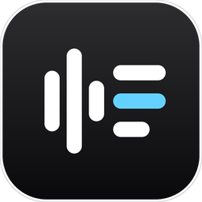
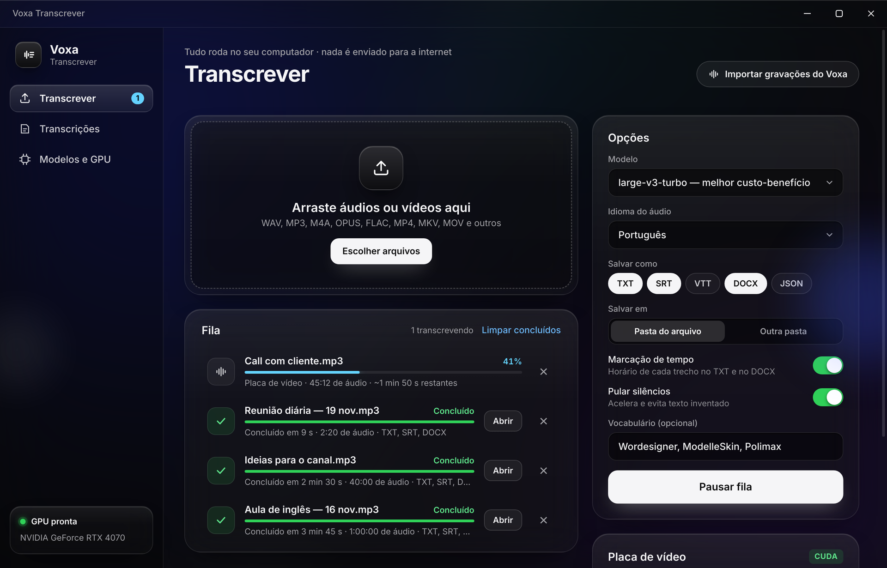
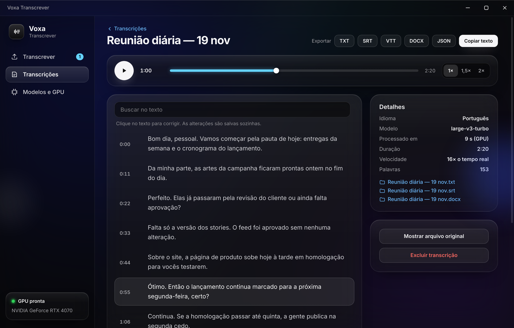
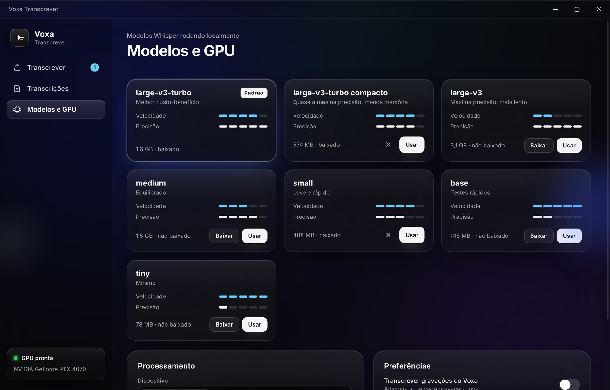

<p align="center">
  
</p>

<h1 align="center">Voxa Transcrever</h1>

<p align="center">
  Transcrição de áudio e vídeo no seu computador, acelerada pela placa de vídeo.<br>
  Sem nuvem, sem assinatura, sem limite de minutos.
</p>

<p align="center">
  <a href="../../releases/latest"></a>
  
  
</p>

<p align="center">
  
</p>

---

## Por que usar

- **Privado de verdade.** O áudio nunca sai do seu computador. Reuniões, entrevistas, consultas e aulas ficam só com você.
- **Rápido na GPU.** Em placas NVIDIA, a transcrição roda em CUDA, muitas vezes mais rápido que no processador.
- **Sem custo por minuto.** Transcreva horas de áudio sem plano, crédito ou conta.
- **Pronto para usar.** Arraste o arquivo, escolha o formato e receba TXT, SRT, VTT, DOCX ou JSON ao lado do original.

## Recursos

| | |
|---|---|
| **Fila de arquivos** | Arraste vários áudios ou vídeos de uma vez. Pausar, cancelar e tentar de novo. |
| **Áudio e vídeo** | WAV, MP3, M4A, AAC, OGG, OPUS, FLAC, WMA, WEBM, MP4, MKV, MOV, AVI e outros (via FFmpeg). |
| **Formatos de saída** | TXT (com ou sem horário), SRT e VTT para legendas, DOCX para Word, JSON para integrações. |
| **Editor de transcrição** | Ouça o áudio, clique num horário para pular até ele e corrija o texto direto na tela. |
| **Vocabulário** | Informe nomes próprios e termos técnicos para o modelo acertar a grafia. |
| **Pular silêncios** | Detecção de voz (VAD) que acelera o processo e evita frases inventadas em trechos mudos. |
| **Modelos Whisper** | Do `tiny` ao `large-v3`, com o `large-v3-turbo` como padrão. Baixe só o que for usar. |
| **Monitor da GPU** | Uso da placa e da memória de vídeo em tempo real durante a transcrição. |
| **Plano B automático** | Se a GPU falhar (driver antigo, por exemplo), o arquivo é refeito no processador. |
| **Integração com o Voxa** | Importa as gravações do Voxa (gravador agendado) e pode transcrever cada gravação nova sozinho. |

<p align="center">
  
</p>

## Download e instalação

1. Baixe o arquivo `Voxa-Transcrever-x.y.z-win-x64.zip` na página de [Releases](../../releases/latest).
2. Extraia a pasta **Voxa Transcrever** para um local fixo, por exemplo `D:\Programas\Voxa Transcrever`.
3. Abra **Voxa Transcrever.exe**.

> **Aviso do Windows SmartScreen:** o app ainda não tem assinatura digital, então o Windows pode mostrar
> "O Windows protegeu o computador". Clique em **Mais informações › Executar assim mesmo**.

Não precisa instalar Python, CUDA Toolkit nem nada além do driver da placa de vídeo.

## Primeiro uso

Na primeira vez, o app mostra dois avisos com botões:

1. **Baixar o modelo** — o `large-v3-turbo` tem 1,6 GB e fica salvo no computador. Depois disso, tudo funciona offline.
2. **Ativar a aceleração pela placa de vídeo** (só para NVIDIA) — download único de cerca de 670 MB com o motor CUDA.
   Ele não vem no ZIP para manter o download inicial pequeno.

Pronto: arraste os arquivos para a janela.

## Requisitos

| | Mínimo | Recomendado |
|---|---|---|
| Sistema | Windows 10 64 bits | Windows 11 64 bits |
| Placa de vídeo | Qualquer (roda no processador) | NVIDIA GeForce GTX 10xx ou mais nova, driver atualizado |
| Memória de vídeo | — | 4 GB ou mais para o `large-v3-turbo` |
| Espaço em disco | 600 MB + modelo | 3 GB |

**Placas AMD e Intel:** o app funciona normalmente, mas a transcrição roda no processador.
Nesse caso, prefira os modelos `large-v3-turbo compacto` ou `small`.

## Modelos

| Modelo | Tamanho | Quando usar |
|---|---|---|
| `large-v3-turbo` | 1,6 GB | **Padrão.** Melhor equilíbrio entre velocidade e precisão. |
| `large-v3-turbo compacto` | 574 MB | Quase a mesma precisão, usa bem menos memória de vídeo. |
| `large-v3` | 3,1 GB | Máxima precisão, mais lento. |
| `medium` | 1,5 GB | Equilibrado, bom no processador. |
| `small` | 488 MB | Leve e rápido. |
| `base` / `tiny` | 148 MB / 78 MB | Testes rápidos. |

<p align="center">
  
</p>

## Solução de problemas

<details>
<summary><b>"Faltou memória de vídeo"</b></summary>

Troque para o modelo **large-v3-turbo compacto** em *Modelos e GPU*, ou feche jogos e editores de vídeo abertos enquanto transcreve.
</details>

<details>
<summary><b>A placa NVIDIA não é usada</b></summary>

- Atualize o driver da NVIDIA (o motor usa CUDA 12).
- Em *Modelos e GPU › Dispositivo*, deixe em **Automático** ou **Placa de vídeo**.
- Confira se o aviso "Ative a aceleração" sumiu da tela inicial; se não, clique em **Ativar**.
</details>

<details>
<summary><b>O texto saiu com nomes errados</b></summary>

Escreva os nomes e termos no campo **Vocabulário** (por exemplo: `Wordesigner, ModelleSkin, Polimax`) e transcreva de novo.
</details>

<details>
<summary><b>"Arquivo inválido ou corrompido"</b></summary>

O arquivo não tem uma faixa de áudio legível. Tente abrir no seu player; se tocar, converta para MP3 ou WAV e adicione de novo.
</details>

<details>
<summary><b>Onde ficam os arquivos?</b></summary>

- Transcrições exportadas: na mesma pasta do áudio original (ou na pasta escolhida em *Salvar em*).
- Modelos e motor da GPU: `%LOCALAPPDATA%\VoxaTranscrever`
- Histórico e configurações: `%APPDATA%\Voxa Transcrever`
</details>

## Privacidade

O Voxa Transcrever não tem conta, telemetria nem servidor. A internet só é usada quando **você** clica para baixar um modelo
(Hugging Face) ou o motor da GPU (GitHub). O áudio e o texto ficam no seu disco.

## Compilar a partir do código

O app é feito em [Electron](https://www.electronjs.org/), usa o [whisper.cpp](https://github.com/ggml-org/whisper.cpp)
como motor e o [FFmpeg](https://ffmpeg.org/) para converter o áudio.

```bash
# 1. dependências de build e do app
npm install
npm --prefix app install

# 2. baixa Electron para Windows, motor do whisper.cpp (CPU), FFmpeg e runtime do Visual C++
npm run deps

# 3. rodar em modo de desenvolvimento (no Windows)
npm start

# 4. gerar a pasta "dist/Voxa Transcrever" e o ZIP
npm run build:win
```

O empacotamento funciona em Windows, Linux ou macOS (precisa de `bash`, `curl`, `unzip` e `zip`; no Windows, use o Git Bash).
O runtime do Visual C++ é baixado pelo `pip` — sem Python, instale o
[Visual C++ Redistributable](https://learn.microsoft.com/cpp/windows/latest-supported-vc-redist) no computador de destino.

### Estrutura

```
app/
  main.js          processo principal: fila, FFmpeg, whisper.cpp, downloads, GPU
  exporters.js     TXT, SRT, VTT, DOCX e JSON
  preload.js       ponte segura entre a interface e o processo principal
  renderer/        interface (HTML, CSS e JS puro)
scripts/
  baixar-dependencias.sh
  empacotar.js
docs/img/          capturas de tela
```

## Próximos passos

Ideias em estudo, sem data definida:

- Separação de falantes (quem disse o quê).
- Aceleração por Vulkan para placas AMD e Intel.
- Instalador com atalho na área de trabalho e atualização automática.
- Tradução direta para o inglês.

Sugestões são bem-vindas nas [Issues](../../issues).

## Créditos

- [whisper.cpp](https://github.com/ggml-org/whisper.cpp) — motor de transcrição (MIT)
- Modelos [Whisper](https://github.com/openai/whisper) da OpenAI (MIT)
- [FFmpeg](https://ffmpeg.org/) — conversão de áudio e vídeo (LGPL 2.1+)
- [Electron](https://www.electronjs.org/) (MIT), [docx](https://github.com/dolanmiu/docx) (MIT), fonte [Inter](https://rsms.me/inter/) (OFL)

Detalhes em [THIRD-PARTY-NOTICES.md](THIRD-PARTY-NOTICES.md).

## Licença

Código do Voxa Transcrever sob a licença [MIT](LICENSE). © 2026 Wordesigner.

<sub>As capturas de tela usam arquivos e textos de exemplo.</sub>
